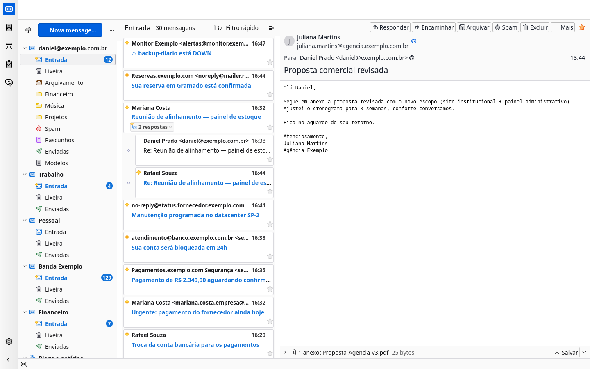
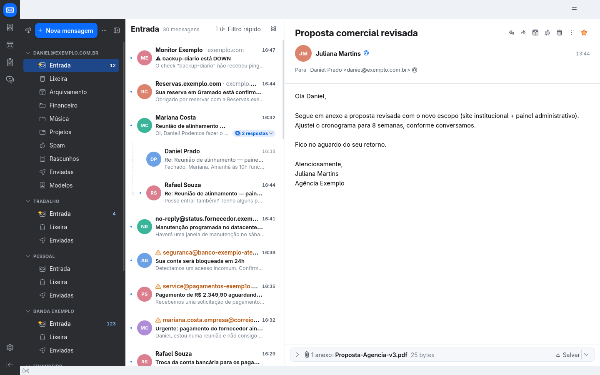
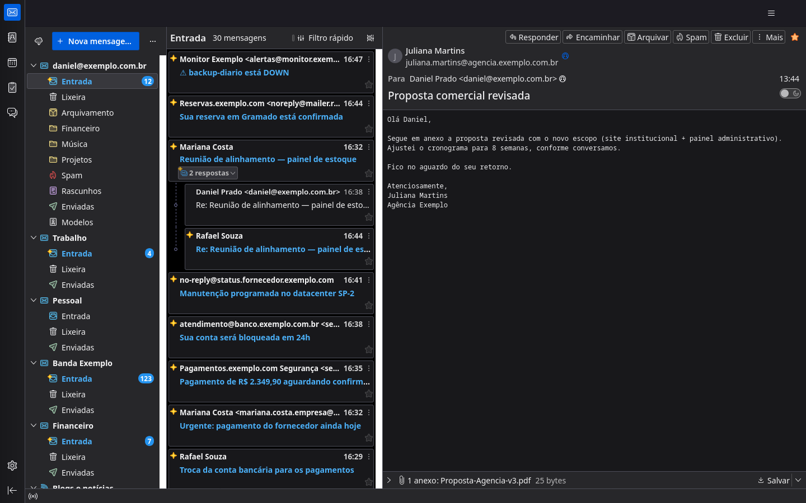
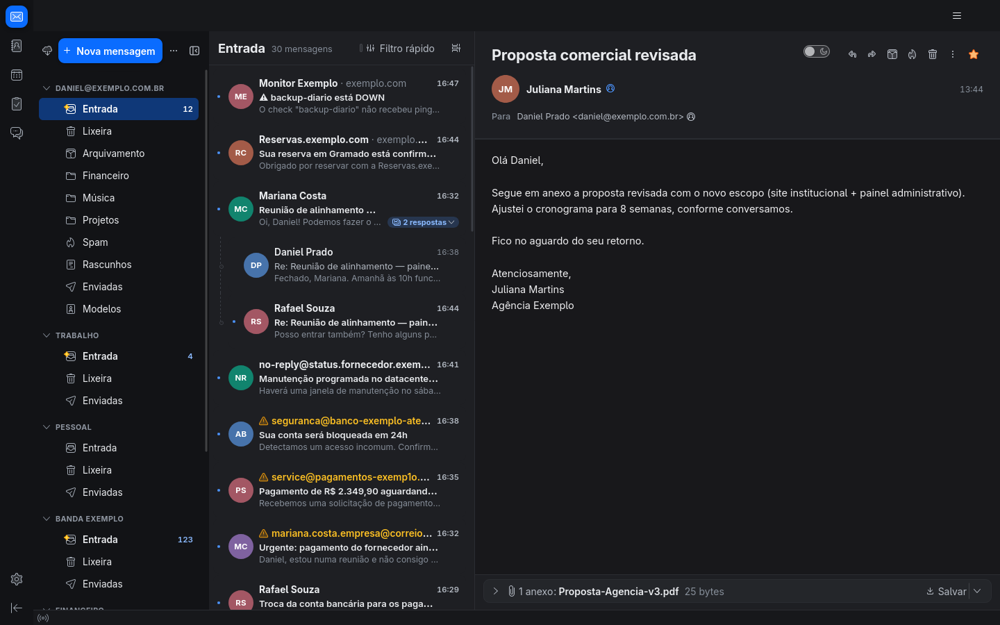
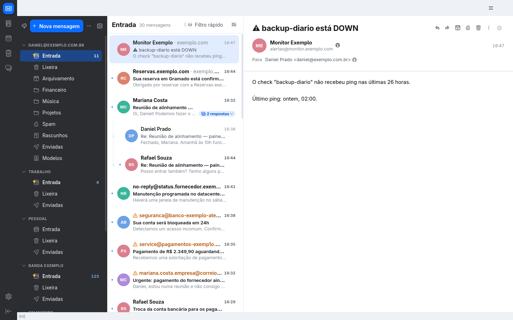
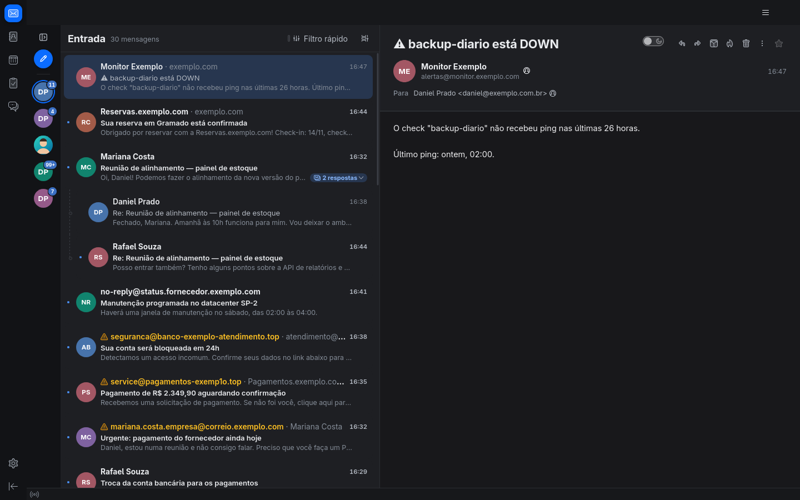
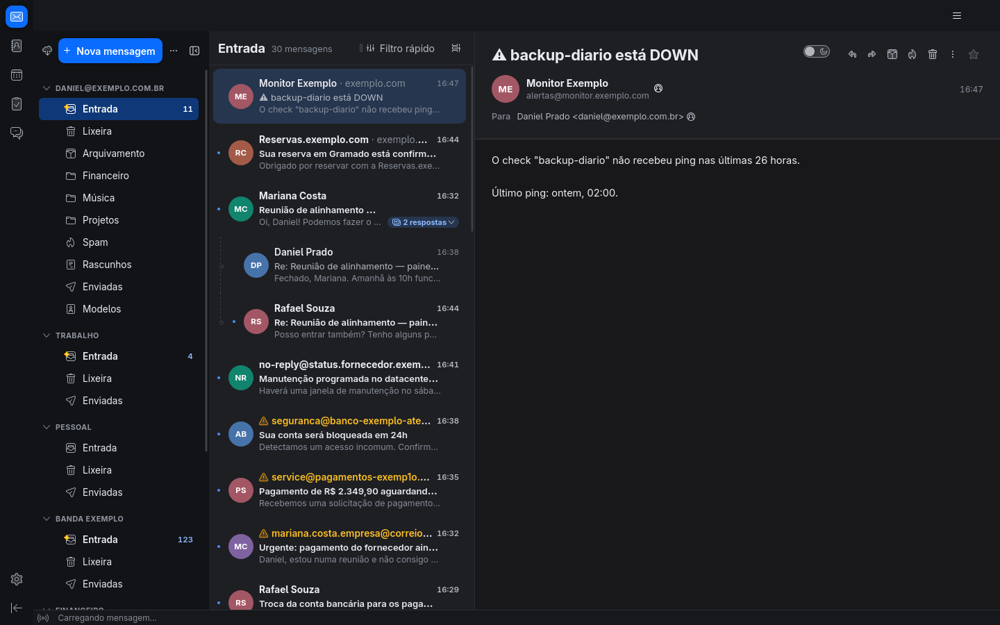
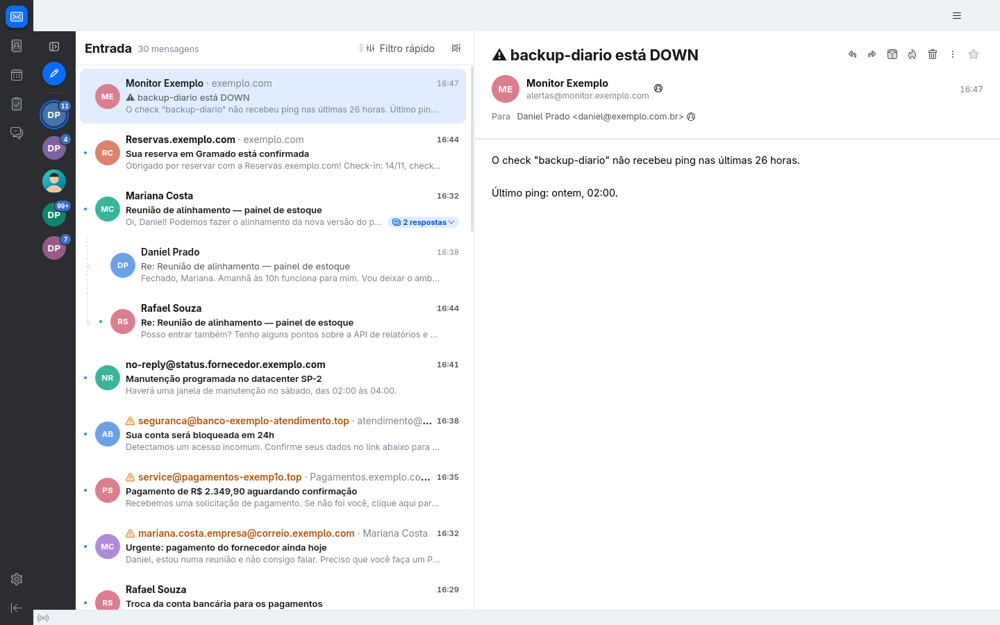
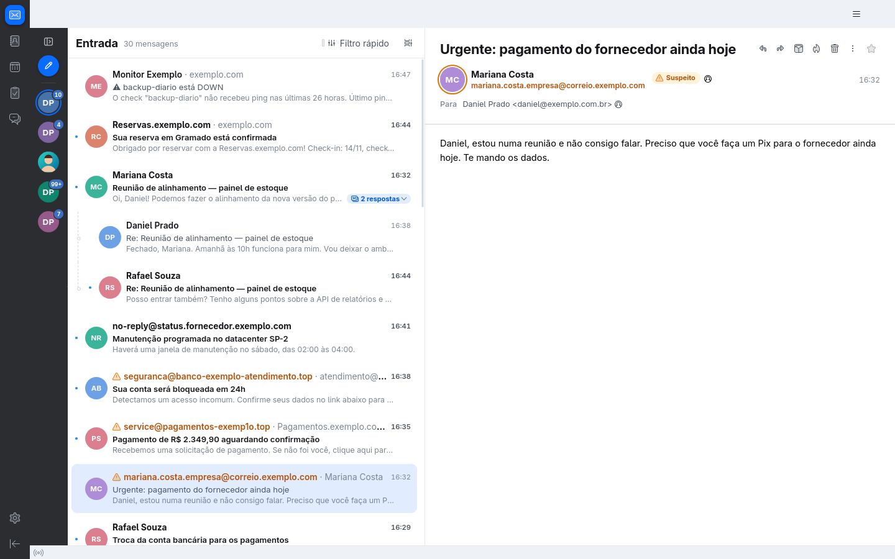
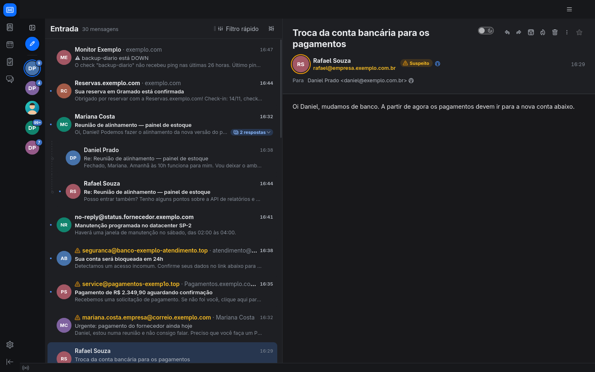

# theUnfound Theme

Addon que recria no **Thunderbird 158** o visual do Spark Mail (Spark
Desktop 3, da Readdle): barra lateral escura em grafite com seleção em
"pílula" azul (ou clara, se preferir), painel de pastas que se recolhe num
trilho só com as fotos das contas, lista de mensagens com avatar, remetente em
negrito, data à direita e prévia do conteúdo, barra superior limpa com busca
arredondada e painel de leitura branco com assunto grande. Funciona no modo
claro e no escuro.

É só aparência: nenhuma função do Thunderbird é removida ou alterada, nada é
gravado nas suas mensagens e tudo volta ao normal ao desativar ou remover o
addon.

| Antes | Depois |
| --- | --- |
|  |  |
|  |  |

Mais capturas em [`screenshots/`](screenshots/): trilho de contas, barra
clara e a página de opções.

## Novidades da 0.4.1

- **Nenhuma mudança de aparência:** esta versão não altera um pixel da
  interface. É só uma reescrita interna do CSS.
- **CSS sem aninhamento de seletor:** os 208 sítios de aninhamento nativo
  das oito folhas de estilo foram achatados — cada `&` virou o seletor do
  pai —, sem mexer em nenhum seletor efetivo nem em nenhuma declaração. O
  validador da addons.thunderbird.net apontava 56 avisos "Invalid nesting of
  selectors found" no upload da 0.4.0; sem seletor aninhado, eles não têm
  mais como aparecer.

## Novidades da 0.4.0

- **Nome e identidade próprios:** o addon passou a se chamar **theUnfound
  Theme para Thunderbird**, com id permanente `theme@theunfound.com.br` e um
  ícone novo, que mostra o motivo do próprio tema.
- **Licença MPL 2.0** declarada (veja [Licença](#licença)), preparando a
  primeira publicação na addons.thunderbird.net.
- O visual não mudou: a barra escura e o trilho de contas da 0.3.0 continuam
  iguais. Como o id é novo, porém, o Thunderbird vê a 0.4.0 como outro
  complemento: quem tinha uma versão anterior precisa **removê-la** antes de
  instalar esta — veja [Instalar](#instalar).

## Novidades da 0.3.0

- **Barra lateral escura** (padrão): a barra de áreas e o painel de pastas
  viram uma coluna em grafite, com a pasta selecionada numa pílula azul
  sólida. A barra clara das versões anteriores continua nas opções.
- **Trilho de contas:** o painel de pastas se recolhe num trilho estreito só
  com a foto de cada conta e as não lidas da Caixa de entrada; clique para
  abrir a Entrada da conta. A foto pode ser escolhida nas opções (seção
  "Contas"), vir do catálogo de endereços ou ficar nas iniciais.
- Tudo isso sobre a base da 0.2.1 (estado por instância): dá para instalar a
  0.3.0 por cima da 0.2.0 ou da 0.2.1 sem reiniciar — veja
  [Atualizar](#instalar).

| Barra escura, tema claro | Trilho de contas, tema escuro |
| --- | --- |
|  |  |

## O que muda

- **Barra lateral (pastas):** escura em grafite, junto com a barra de áreas
  (ou clara, cinza-azulada, nas opções); ícones monocromáticos, itens com
  cantos arredondados e seleção em pílula azul; contas viram títulos de
  seção; contadores discretos; botão "Nova mensagem" azul e arredondado.
- **Trilho de contas:** um botão no topo do painel de pastas recolhe o painel
  num trilho estreito só com a foto de cada conta e o número de não lidas da
  Entrada (veja abaixo).
- **Lista de mensagens** (visualização em cartões do Thunderbird):
  - avatar circular com iniciais coloridas — ou a foto do contato, se ele
    estiver no catálogo de endereços com foto;
  - remetente em negrito, data em cinza à direita, assunto e uma linha de
    prévia do conteúdo;
  - não lidas com ponto azul e texto em negrito;
  - seleção em azul claro com cantos arredondados, sem bordas;
  - estrela e menu "⋮" só aparecem ao passar o mouse (continuam clicáveis);
  - remetente em **nome inteligente**: só o nome para quem você conhece,
    nome + domínio para desconhecidos e alerta para suspeitos (veja abaixo).
- **Barra superior:** sem bordas, formando uma moldura única com a barra
  lateral; campo de busca arredondado no centro.
- **Painel de leitura:** assunto grande no topo, avatar colorido do remetente,
  nome em negrito, endereço e data em cinza, ações só com ícone (o nome fica
  na dica); barra de anexos arredondada; mais respiro em volta do corpo e, se
  quiser, fonte proporcional nas mensagens de texto simples.
- **Barra de áreas** (ícones à esquerda), **abas**, **barra de status**,
  **janela de mensagem avulsa** e **janela de composição** acompanham a paleta.
- **Claro / escuro / automático**, escolhido na página de opções.

## Barra lateral escura e trilho de contas

A barra de áreas (ícones à esquerda) e o painel de pastas formam uma coluna
escura contínua, em grafite, enquanto a lista de mensagens,
a leitura e a barra superior seguem o tema escolhido. A pasta selecionada vira
uma pílula azul sólida com o contador de não lidas dentro; sem o foco no
painel, a pílula fica mais apagada, e com o foco vindo do teclado (Tab, F6,
setas) ganha um anel claro. Passar o mouse, arrastar mensagens para uma pasta
e abrir o menu de contexto de uma pasta também têm realce próprio. Menus e
popups continuam no tema da janela. No tema escuro, a barra fica um tom abaixo
do resto da janela. A opção **Barra lateral escura** (ligada por padrão) volta
à barra clara.

O botão com o ícone de barra lateral, no canto direito do cabeçalho do painel
de pastas (ao lado do "⋯"), recolhe o painel num **trilho de contas** de
60 px:

- uma foto por conta de e-mail, na ordem das contas do Thunderbird. A foto é,
  nesta ordem: a imagem escolhida nas opções do addon para aquela conta; a
  foto do contato com o mesmo e-mail (identidade padrão da conta) em algum
  catálogo de endereços; ou as iniciais coloridas, com a mesma cor que a
  pessoa teria na lista de mensagens;
- no canto superior direito de cada foto, o número de **não lidas da Caixa de
  entrada** daquela conta (subpastas não contam), atualizado na hora; some com
  0 e mostra "99+" acima de 99;
- clicar na foto abre a Entrada da conta; a conta da pasta aberta ganha um
  anel azul. A dica mostra nome da conta, e-mail e não lidas;
- no topo, o botão de expandir e "Nova mensagem" como ícone;
- contas sem Caixa de entrada — Pastas locais, feeds, grupos de notícias e
  bate-papo — **não aparecem**: o trilho serve para pular entre Entradas, e
  essas contas não têm o que abrir nem contar (continuam no painel expandido).

Tudo funciona pelo teclado: as fotos são botões (Tab, Enter/Espaço, setas
para cima/baixo, Home/End) com o nome da conta e as não lidas lidos pelo
leitor de tela, e F6 passa pelo trilho em vez da árvore de pastas escondida.
O estado (recolhido ou não) vale para todas as janelas e sobrevive a
reinícios. A largura do painel não é alterada: ao expandir, ou ao desativar o
addon, ele volta exatamente à largura que tinha. O trilho funciona com a barra
escura ligada ou desligada.

| Barra escura, tema claro | Barra escura, tema escuro |
| --- | --- |
|  |  |
|  |  |

Também em [`screenshots/`](screenshots/): barra clara
(`barra-clara-claro.png`), trilho com a barra clara
(`trilho-barra-clara-claro.png`), painel expandido de volta na largura
anterior (`trilho-expandido-de-volta.png`), o Thunderbird com o addon
desativado (`addon-desativado.png`) e a seção "Contas" das opções
(`opcoes-contas.png`).

## Remetente: nome inteligente

Mostrar só o nome de quem escreveu é mais limpo — mas é exatamente o que um
golpista explora (qualquer um pode se chamar "Banco Exemplo" ou "Mariana
Costa"). O modo **nome inteligente** (padrão) mantém o visual limpo e só
mostra mais informação quando ela importa:

| Remetente | Na lista | No painel de leitura |
| --- | --- | --- |
| **Conhecido** — o endereço está em algum catálogo de endereços (inclusive "Endereços coletados", que guarda quem você já respondeu) ou é uma identidade sua | só o nome — o do **seu catálogo**, não o que veio no e-mail | nome |
| **Desconhecido** | nome · `dominio.com` em cinza (ex.: "Monitor Exemplo · exemplo.com"); sem nome, o endereço | nome + endereço |
| **Suspeito** | ⚠ endereço completo em âmbar · nome alegado | nome, endereço em âmbar, selo "Suspeito" e anel âmbar no avatar |

É **suspeito** um remetente desconhecido quando:

- **(a)** o nome exibido contém um endereço de e-mail diferente do real
  (ex.: nome "atendimento@banco.exemplo.com.br", endereço
  `seguranca@banco-exemplo-atendimento.top`);
- **(b)** o nome cita um domínio cujo domínio registrável é outro (ex.: nome
  "Pagamentos.exemplo.com Segurança", endereço `service@pagamentos-exemp1o.top`);
  domínios só contam se o sufixo for real (`.com`, `.com.br`, `.io`…), então "Sr.Silva" ou
  "Node.js" não disparam;
- **(c)** o nome é igual (ignorando maiúsculas e acentos) ao de um contato seu,
  mas o endereço não é de nenhum contato com esse nome (ex.: "Mariana Costa"
  escrevendo de um endereço pessoal em outro domínio). Não dispara se o endereço for do mesmo domínio de
  empresa do contato (outra caixa da mesma organização); provedores gratuitos
  como Gmail/Outlook não contam como "mesma organização";
- **(d)** no painel de leitura, qualquer remetente — mesmo conhecido — cujo
  servidor marcou **DMARC** ou **SPF** como `fail` no primeiro cabeçalho
  `Authentication-Results` (o acrescentado pelo último servidor, normalmente
  o seu). É o caso de alguém falsificando o endereço exato de um contato.

| Imitação de contato (c) | Endereço de contato reprovado no DMARC (d) |
| --- | --- |
|  |  |

O motivo aparece na dica (passe o mouse no remetente), que também mostra
sempre o endereço completo. Em mensagens enviadas, as mesmas regras valem
para cada destinatário. Se você usa o addon **Auto Profile Picture**, o logo
dele não aparece em remetentes suspeitos (um domínio parecido pode herdar o
logotipo de outro).

Nas opções há também **Sempre nome e endereço** ("Nome <endereço>" para todos,
com os mesmos alertas) e **Só o nome (sem proteção)**, que é o comportamento
antigo, sem alertas. Quem tinha a opção antiga "só o nome do remetente"
ligada passa para o nome inteligente; desligada, para nome e endereço.

## Gerar o .xpi

Requer `zip` e `python3`.

```sh
scripts/build.sh
# → dist/theunfound-theme.xpi
```

## Instalar

**Instalação normal (permanente):**

1. No Thunderbird, abra **Ferramentas › Extensões e temas** (ou menu ☰ ›
   Extensões e temas).
2. Clique no ícone de **engrenagem** › **Instalar de um arquivo…**.
3. Escolha `dist/theunfound-theme.xpi` e confirme.

O addon não é assinado pela Mozilla. O Thunderbird aceita complementos não
assinados por padrão (`xpinstall.signatures.required = false`) e permite
*Experiment APIs* (`extensions.experiments.enabled = true`, padrão no
Thunderbird). Se o seu perfil tiver mudado essas preferências, volte-as aos
valores padrão no editor de configuração (**Configurações › Geral**, botão do
editor de configuração no fim da página).

**Atualizar:** instale o `.xpi` novo **por cima** (o mesmo "Instalar de um
arquivo…"), sem remover o antigo e sem precisar reiniciar. Evite "Remover" e
instalar em seguida na mesma tela de complementos: se a barra "… foi removido
— Desfazer" ainda estiver aberta, o Thunderbird conclui aquela remoção ao sair
da lista e leva junto a versão recém-instalada; e "Desfazer" depois de instalar
por cima deixa duas cópias do addon rodando. A partir da 0.2.1 o addon se
recupera desses casos (a cópia nova desliga as anteriores, inclusive da
0.1.0/0.2.0, e nada de uma limpeza atrasada delas alcança a nova). Quem ficou
com o visual sumido na 0.2.0 só precisa instalar uma versão nova por cima. Da
0.2.0 ou da 0.2.1 para a 0.3.0 vale o mesmo: instale por cima; a barra escura
e o trilho de contas aparecem na hora, sem reiniciar, e as opções salvas são
mantidas.

**Vindo de uma versão anterior à 0.4.0:** nela o addon ganhou nome e id novos
(`theme@theunfound.com.br`), e o id é o que o Thunderbird usa para reconhecer
um complemento. Então a 0.4.0 **não** entra por cima: ela seria instalada ao
lado da antiga, e as duas rodariam juntas — cada uma injetando suas folhas e
envolvendo o `fillRow` da lista, já que a desativação automática de instâncias
só reconhece as da própria versão. Remova a versão antiga em **Extensões e
temas**, instale a 0.4.0 e reajuste as opções — elas ficam no armazenamento do
complemento antigo e não são herdadas. Da 0.4.0 em diante a instalação por
cima volta a valer.

**Carregar temporariamente (para testar ou desenvolver):** **Ferramentas ›
Ferramentas de desenvolvimento › Depurar extensões** › **Carregar extensão
temporária…** e escolha `addon/manifest.json` (ou o `.xpi`). Ele some ao fechar
o Thunderbird.

## Opções

Em **Extensões e temas › theUnfound Theme para Thunderbird › Preferências**:

- **Tema:** Automático (segue o Thunderbird/sistema), Claro ou Escuro.
- **Barra lateral escura** (padrão: ligada).
- **Contas:** a foto de cada conta no trilho, com "Escolher imagem…" (PNG,
  JPEG, WebP ou GIF; recortada ao centro e reduzida para 128 × 128, guardada
  só no armazenamento do addon) e "Remover" (volta à foto do catálogo ou às
  iniciais).
- **Avatares** e **linha de prévia**.
- **Remetente:** nome inteligente (recomendado), sempre nome e endereço, ou
  só o nome (sem proteção) — veja acima.
- **Fonte proporcional em mensagens de texto simples.**
- **Usar cartões e 3 colunas:** o visual foi pensado para a visualização em
  cartões (3 linhas) e o layout vertical (pastas | lista | leitura), que já são
  o padrão do Thunderbird 158. Se você tiver mudado isso, o botão volta essas
  três preferências do Thunderbird para esses valores. O addon não altera
  nenhuma preferência sem você clicar nele.

Dica: o campo de busca central é a **pesquisa global** do Thunderbird, que só
aparece com o indexador ligado (**Configurações › Geral**, seção de pesquisa e
desempenho: "Ativar pesquisa global e indexador"). No Fedora ela vem
desligada; sem ela a barra superior fica vazia (limpa, mas sem a busca). O modo **Pastas unificadas**
(menu "⋯" da barra lateral › Modos de pastas) junta as Entradas de todas as
contas numa coluna só e deixa a barra lateral ainda mais limpa.

## Como funciona

O addon é uma WebExtension (Manifest V3) com uma *Experiment API*
(`experiments/unfoundTheme/`) que roda com privilégios do Thunderbird:

- No Thunderbird 158 cada parte da janela é um documento separado:
  `messenger.xhtml` (barra unificada, barra de áreas, abas), `about:3pane`
  (pastas, lista, moldura da leitura) dentro de cada aba de e-mail,
  `about:message` (cabeçalho da mensagem), o corpo da mensagem, a janela de
  mensagem avulsa e a de composição. O experimento observa a criação de
  documentos (`document-element-inserted`), reconhece esses e injeta neles as
  folhas de estilo de `addon/skin/` com `windowUtils.loadSheetUsingURIString`
  (folhas de autor). Janelas e abas já abertas são tratadas ao iniciar.
- O que CSS não alcança fica em dois scripts pequenos, carregados dentro dos
  próprios documentos (`addon/content/`): um envolve o `fillRow` dos cartões da
  lista para acrescentar avatar, prévia e a linha do remetente; o outro colore
  o avatar do cabeçalho e marca o remetente. As regras do remetente ficam num
  módulo compartilhado (`SenderTrust.sys.mjs`), com cache por endereço que é
  limpo quando o catálogo de endereços muda.
  A prévia vem da propriedade `preview` que o Thunderbird já mantém no banco de
  mensagens; quando ela falta, o addon pede ao Thunderbird que a gere
  (`fetchMsgPreviewText`), só para as linhas visíveis.
- A barra lateral fica num terceiro script, carregado em cada janela
  principal (`sidebarDecorator.js`), que cuida de todas as abas de e-mail
  dela (o `DOMContentLoaded` de cada `about:3pane` chega até a janela). A
  barra escura é só CSS (`skin/sidebar.css`): a barra de áreas e o painel de
  pastas recebem `color-scheme: dark`, então a própria paleta `light-dark()`
  do addon e do Thunderbird resolve para os tons escuros ali dentro. O trilho
  é montado dentro de `#folderPane`; recolhido, um atributo na raiz de
  `about:3pane` faz o CSS esconder a árvore e sobrepor, com `!important`, a
  variável de largura que o splitter grava no `<body>` — a largura salva pelo
  Thunderbird nunca muda. As não lidas vêm de um ouvinte de pastas
  (`MailServices.mailSession`), as contas de observadores de preferências e as
  fotos do catálogo de observadores do catálogo; o estado recolhido fica no
  xulstore.
- O tema claro/escuro forçado usa `prefersColorSchemeOverride` do contexto de
  navegação de cada janela, então tudo que segue o `prefers-color-scheme` do
  Thunderbird acompanha.
- Cada início do addon é uma **instância** com id próprio, dona do que pôs nas
  janelas: o host `resource://theunfound-theme-<id>/`, os atributos de raiz
  `unf-*` (o `unf-ui` guarda o id do dono; `unf-light-sidebar` e
  `unf-folder-rail`, do decorador da barra lateral, também) e o decorador de
  cada documento (`window.UnfoundSkinDecorator` em `about:3pane`,
  `about:message` e na janela principal). Ao iniciar, ela desliga qualquer outra
  instância do addon que ainda esteja rodando e substitui decoradores antigos;
  ao desligar, só desfaz o que é dela. Assim uma atualização sem reiniciar, uma
  ordem de desligamento trocada ou uma cópia órfã deixada pelo Thunderbird não
  apagam o visual da versão nova.
- Ao desativar, remover ou atualizar, tudo é desfeito: folhas removidas,
  scripts desinstalados (o `fillRow` original volta e os cartões são
  redesenhados), atributos e host `resource://` removidos e cache de
  inicialização invalidado.

```
addon/
  manifest.json
  background.js                 aplica as opções salvas
  experiments/unfoundTheme/     schema.json + implementation.js (injeção)
  skin/                         tokens.css (paleta), messenger.css,
                                about3pane.css, aboutMessage.css,
                                messageContent.css, compose.css,
                                sidebar.css (barra escura e trilho)
  content/                      threadDecorator.js, messageDecorator.js,
                                SenderTrust.sys.mjs (regras do remetente),
                                sidebarDecorator.js (trilho de contas)
  options/                      página de opções
  icons/icon.svg                ícone próprio: barra lateral escura com o
                                trilho de contas à esquerda e cartões de
                                mensagem à direita, sobre o quadrado azul
scripts/build.sh                gera o .xpi
tools/                          ferramentas de desenvolvimento (abaixo)
docs/publicacao/                dossiê da submissão à addons.thunderbird.net
screenshots/                    as capturas deste README
LICENSE                         Mozilla Public License 2.0
```

## Limitações conhecidas

- Testado só no Thunderbird 158 (Linux, Fedora). Os seletores dependem da
  estrutura interna do Thunderbird e podem precisar de ajustes em versões
  futuras. O `strict_min_version` é 140 (ESR), mas versões antigas não foram
  testadas. Como o addon usa uma *Experiment API*, o Thunderbird exige um
  `strict_max_version`: ele está em `158.*`. Ao atualizar o Thunderbird para
  uma versão maior, suba esse número em `addon/manifest.json` e gere o `.xpi`
  de novo — `scripts/build.sh` recusa empacotar sem ele.
- O visual é uma recriação com CSS próprio — nenhum ícone, fonte ou imagem de
  outro programa é usado. Os ícones continuam os do Thunderbird.
- Não acrescenta nenhum recurso de triagem (caixa de entrada inteligente,
  agrupamento de newsletters, "concluir", soneca, etc.): é só aparência.
- A visualização em **tabela** recebe apenas as cores; avatares e prévia
  existem só na visualização em **cartões** de 3 linhas.
- Em contas IMAP sem cópia local das mensagens, gerar a prévia pode baixar o
  início do corpo das mensagens visíveis (o mesmo que o Thunderbird faz para
  os alertas de novas mensagens). Se não quiser isso, desligue a prévia.
- A busca central depende da busca global/indexação do Thunderbird (veja a
  dica acima).
- No tema forçado (Claro/Escuro diferente do sistema), o corpo de e-mails HTML
  segue o modo escuro nativo do Thunderbird, que tem um botão próprio no
  cabeçalho da mensagem.
- Agenda, tarefas e bate-papo (que ficam na janela principal) herdam só a
  paleta geral, sem desenho específico. O catálogo de endereços e a aba de
  resultados da pesquisa global não são alterados.
- Temas de terceiros (temas "leves") são sobrepostos pelas cores do addon.
- **Nome inteligente:** é uma heurística, não um filtro antifraude. "Conhecido"
  depende do seu catálogo: um contato que escreve de um endereço novo cai em
  (c) até você salvar esse endereço; uma conta comprometida de um contato
  continua "conhecida". A checagem (d) só olha a cópia local da mensagem
  (POP, pastas locais e IMAP com sincronização offline, que é o padrão) e
  confia no primeiro `Authentication-Results`. Domínios internacionalizados
  parecidos (homógrafos) não têm regra própria — só aparecem pelo domínio
  exibido. Só o remetente (De) é analisado no cabeçalho; Para/Cc/Responder-a
  não.
- **Barra escura:** a barra superior, as abas e a barra de status continuam no
  tema da janela (só a coluna da esquerda escurece). Ao abrir o Thunderbird
  com a opção desligada, a barra pode aparecer escura por um instante antes do
  addon carregar. Com alto contraste ativo no sistema (`prefers-contrast`), a
  barra escura não é aplicada e a barra volta à clara.
- **Trilho de contas:** o clique abre a Entrada pela árvore de pastas do
  Thunderbird; num modo de pastas que não mostra a Entrada da conta (por
  exemplo, só "Favoritas"), a pasta não muda. A conta só fica realçada quando
  a pasta aberta é dela (pastas unificadas e Pastas locais não realçam
  nenhuma). Contas POP que guardam as mensagens na "Entrada global" das Pastas
  locais mostram a Entrada global. A foto escolhida nas opções é guardada pela
  chave interna da conta (`accountN`): se a conta for apagada e outra criada
  com a mesma chave, ela herda a foto. Enquanto o painel está recolhido, o
  splitter não pode ser arrastado.
- **Auto Profile Picture:** convivência testada com a versão 2.6.0 — quando ele
  tem foto ou logo, ela ocupa o lugar do nosso avatar (mesmo tamanho, sempre
  redondo); quando só tem iniciais, fica o nosso. O formato "quadrado" ou
  "arredondado" das opções dele é ignorado nos cartões.

## Desenvolvimento

Tudo roda num perfil isolado (`.dev-profile/`, fora do git) com o Thunderbird
headless dirigido por Marionette — nunca no seu perfil real.

```sh
tools/dev.sh start                 # sobe o Thunderbird headless (porta 2850)
python3 tools/tbctl.py exec --port 2850 --file tools/seed-profile.js   # conta e mensagens de exemplo
python3 tools/tbctl.py exec --port 2850 --file tools/seed-senders.js   # contatos + remetentes conhecidos/desconhecidos/suspeitos
python3 tools/tbctl.py exec --port 2850 --file tools/seed-accounts.js  # mais contas (0, poucas e 99+ não lidas), feeds e foto no catálogo
tools/dev.sh reload                # (re)instala addon/ como complemento temporário
tools/dev.sh shot nome dark        # cena padrão + screenshots/tmp/nome.png
tools/dev.sh stop
```

- `tools/tbctl.py` — driver Marionette sem dependências (`launch`, `exec` com
  `await` e `--args`, `shot` com `--window-type`/`--size`, `quit`).
- `tools/seed-profile.js` — cria uma conta POP fictícia (sem rede) e ~25
  mensagens realistas em português.
- `tools/seed-senders.js` — contatos no catálogo (pessoal e "Endereços
  coletados") e mensagens cobrindo conhecido, desconhecido e os casos
  suspeitos (a)–(d).
- `tools/seed-accounts.js` — quatro contas POP a mais (Entradas com 4, 0, 123
  e 7 não lidas), uma conta de feeds (fica fora do trilho) e um contato com
  foto para o e-mail de uma delas.
- `tools/dev-scene.js`, `tools/dev-addon.js`, `tools/dev.sh` — cena de
  screenshot e instalação/recarga do addon (`PORT=` e `PROFILE=` trocam a
  porta e o perfil; o log fica em `<perfil>/tb.log`). Com
  `{"action": "xpi", "dir": "/caminho/addon.xpi"}`, o `dev-addon.js` instala
  um `.xpi` como "Instalar de um arquivo…" — para testar atualização por cima
  de outra versão (`"id"` instala outros addons, ex.: Auto Profile Picture).
- `tools/dev-check.js` — diagnóstico: versão instalada, host `resource://`,
  atributos de raiz, efeito das folhas, decorador de cada documento e estado
  da barra lateral (largura do painel, trilho, contas e não lidas).
- `tools/dev-sidebar.js` — cena da barra lateral (tema, recolhido ou não,
  Entrada de qual conta) e estado do trilho; `tools/dev-storage.js` — lê e
  grava o `storage.local` do addon como a página de opções faria (inclusive
  uma foto gerada para uma conta).

O perfil de dev precisa de um `user.js` que desligue o assistente de contas e
telas de boas-vindas (ex.: `mail.provider.suppress_dialog_on_startup`,
`mailnews.start_page.enabled = false`, `mail.shell.checkDefaultClient =
false`) e, para ver mensagens de erro no terminal,
`devtools.console.stdout.chrome = true`.

## Licença

Mozilla Public License 2.0 (MPL-2.0). O texto completo está em
[`LICENSE`](LICENSE), na raiz do repositório, e o `.xpi` gerado por
`scripts/build.sh` leva esse mesmo `LICENSE` dentro dele. Todos os arquivos
empacotados em `addon/` que aceitam comentário trazem no topo o cabeçalho de
três linhas da MPL — os 15 de código (`.js`, `.mjs`, `.css`), a página de
opções (`options/options.html`, comentário HTML depois do `<!DOCTYPE html>`) e
o ícone (`icons/icon.svg`, comentário XML). Só `addon/manifest.json` e
`addon/experiments/unfoundTheme/schema.json` ficam sem, porque JSON não aceita
comentário.

## Marca

Este é um projeto independente, sem vínculo com a Readdle. "Spark" e "Spark
Mail" são marcas da Readdle Technologies Limited, citadas aqui apenas para
descrever a referência visual do addon: não há patrocínio, endosso nem
afiliação. A licença MPL 2.0 cobre o código — ela não concede direitos sobre o
nome "theUnfound Theme" nem sobre o ícone do projeto.
